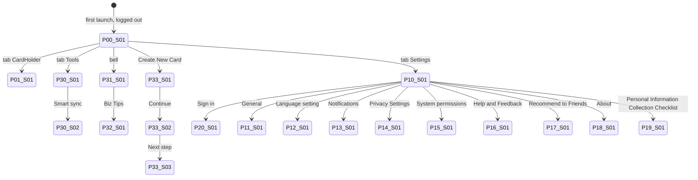
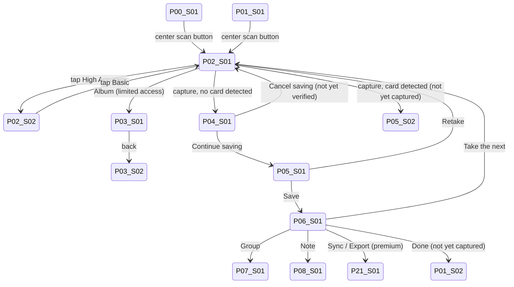

# CamCard state diagrams

Source of truth for navigation. State names use underscores (P01_S01 = P01-S01 in `observations.md`). Transitions marked "not yet captured" are unverified.

## Navigation shell

## Scan flow

